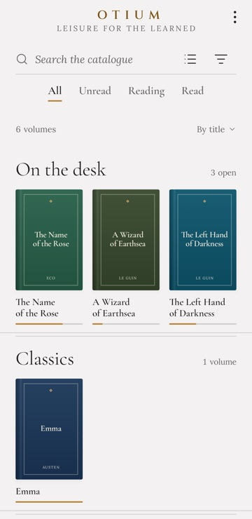
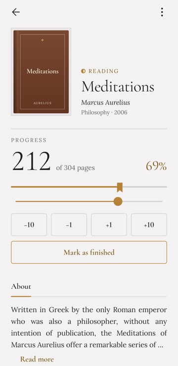
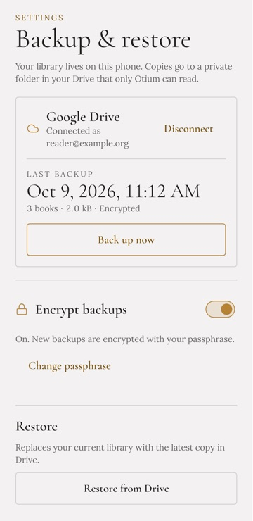
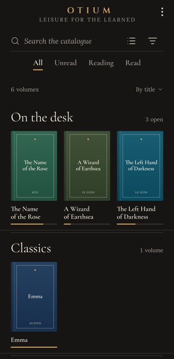
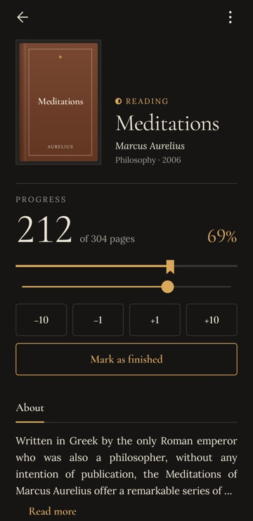
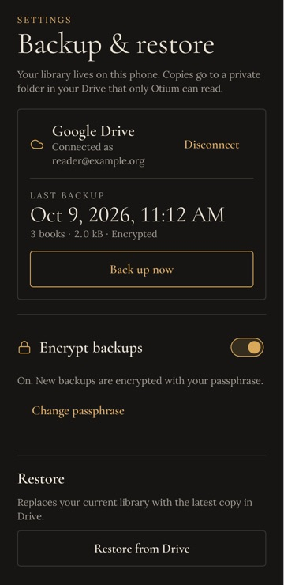
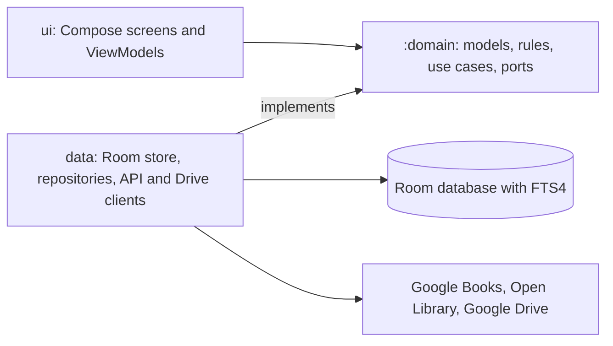

<!-- markdownlint-disable-next-line MD041 -- the title block is centred (docs/MARKDOWN_GUIDE.md) -->
<div align="center">

# Otium


Your personal Alexandria library.

[](https://github.com/eh0x/otium/releases/latest)
[](https://github.com/eh0x/otium/actions/workflows/ci.yml)
[](LICENSE)
[](#requirements)
[](#tech-stack)

[](https://github.com/eh0x/otium/releases/latest)
[](https://apps.obtainium.imranr.dev/redirect?r=obtainium://add/https://github.com/eh0x/otium)

</div>

Otium is an Android app for cataloguing and tracking your own physical books. Scan an ISBN, let it
fetch the details, keep your place by page, and find any book in your library in an instant. It is
built to feel like a quiet study rather than a utility, and it keeps your data on your device.

> [!NOTE]
> Otium is in active development and not on Google Play yet. The version 1 features are built and
> tested on the JVM; device checks, the Google Drive setup, and the accessibility and Play Store
> polish are still to do. See [Status](#status). To try it, see [Install](#install); the changes
> are in [CHANGELOG.md](CHANGELOG.md).

## Contents

- [Screenshots](#screenshots)
- [Features](#features)
- [Privacy](#privacy)
- [Status](#status)
- [Install](#install)
- [Getting started](#getting-started)
- [Architecture](#architecture)
- [Tech stack](#tech-stack)
- [Project structure](#project-structure)
- [Documentation](#documentation)
- [Troubleshooting](#troubleshooting)
- [Contributing](#contributing)
- [Security](#security)
- [Acknowledgements](#acknowledgements)
- [License](#license)

## Screenshots

The library, a book and Settings in the light and dark themes. They are rendered with sample books
by the headless screenshot tests (`app/build/screenshots`).

| | Library | Book | Settings |
|-|---------|------|----------|
| Light |  |  |  |
| Dark |  |  |  |

## Features

- **Add books three ways.** Scan the barcode, type an ISBN, or search by title or author.
- **Good metadata, fixed by you.** Details and covers come from Google Books, with Open Library
  filling the gaps. A confirm screen always comes before saving, because API data is often wrong,
  and every field and the cover can be edited.
- **Shelves and tags.** Each book stands on a shelf (its first category) and can carry tags. Browse
  the library as a shelf of spines or as a list.
- **Reading progress by page.** Set the current and total page. A book is _not started_, _in
  progress_ or _read_, worked out from the pages. The Reading tab keeps the books on your desk and
  the ones you finished recently.
- **Search and filters.** Instant text search over title and author, filtered by status, category
  and tag, with several sort orders. Built for a library of around 5,000 books.
- **Works offline.** Browsing, searching and updating progress need no network. Lookups made
  offline wait for a connection.
- **Backup to your own Google Drive.** A manual backup and an optional scheduled one, stored in
  your private app folder in Drive, with optional passphrase encryption.
- **Import and export.** Bring a library in from a Goodreads or StoryGraph export, and take yours
  out as CSV (in Goodreads' columns, which most reading apps import) or as Otium JSON.

Not in version 1: iOS, syncing between devices, accounts or a backend, ratings and notes, reading
statistics, social features, and several copies of the same ISBN.

## Privacy

- Your library stays on your device. There are no accounts and no analytics.
- The only network calls are to the book APIs, sending an ISBN or a title and author, and to your
  own Google Drive for backup.
- Backups use the private app data folder of your Drive (the `drive.appdata` scope), which the app
  alone can read. With a passphrase set, the backup is encrypted (Argon2id and AES-256-GCM) before
  it leaves the phone.
- Import and export read and write only the files you pick.

## Status

The work follows [the implementation plan](docs/plans/2026-10-06-otium-implementation-plan.md),
which holds the detail and is kept current. This table is a summary.

| Phase | What | State |
|-------|------|-------|
| 0 | Project scaffold, CI | Done |
| 1 | Theme: palette, fonts, shared components | Done |
| 2 | Domain rules and the Room library store | Done |
| 3 | Library, Reading and book detail screens | Done (device timings still to take) |
| 4 | Metadata lookup (Google Books, Open Library) | Done (device check still to do) |
| 5 | Add flow: scan, ISBN, title search | Done (device scan check still to do) |
| 6 | Backup and restore with Google Drive | Built (Drive setup and device check still to do) |
| 7 | Polish, accessibility, Play Store release | Planned |

## Install

Otium runs on Android 8.0 or later.

| Source | Status | Updates |
|--------|--------|---------|
| [GitHub Releases](https://github.com/eh0x/otium/releases/latest) | Available: the signed APK of every release | By hand: download each new release |
| [Obtainium](https://apps.obtainium.imranr.dev/redirect?r=obtainium://add/https://github.com/eh0x/otium) | Available: installs the same APK from GitHub Releases | Automatic: Obtainium checks GitHub for new releases |
| F-Droid | Not available | F-Droid accepts only free software; Otium uses Google Play services (Drive sign-in) and ML Kit (barcode scanning) |
| Google Play | Planned | See [Status](#status) |

The [Obtainium](https://obtainium.imranr.dev/) link opens the app if it is installed and adds
Otium, or offers to install Obtainium first. GitHub Releases and Obtainium install the same APK,
so either can update the other. A later Google Play install is signed with a different key and
cannot replace them: back up, uninstall, then install from Play.

To check a download, compare it with `SHA256SUMS` from the same release, and verify where it was
built with the [GitHub CLI](https://cli.github.com/):

```bash
sha256sum --check --ignore-missing SHA256SUMS
gh attestation verify otium-<version>.apk --repo eh0x/otium
```

To build it yourself instead, see [Getting started](#getting-started). How releases are made is in
the [release guide](docs/RELEASING.md).

## Getting started

### Requirements

- JDK 17 (Temurin recommended)
- Android SDK with platform 37 and build-tools 37 (Android Studio installs these; the command-line
  tools work too)
- Git

The minimum supported Android version is 8.0 (minSdk 26). The application id is `app.otium`.

Contributors need a few more tools for the git hooks; see [CONTRIBUTING.md](CONTRIBUTING.md).

### Quickstart

```bash
git clone https://github.com/eh0x/otium.git
cd otium
echo "sdk.dir=/path/to/Android/sdk" > local.properties   # or set ANDROID_HOME
./gradlew installDebug
```

`./gradlew installDebug` builds the debug APK and installs it on a connected device or a running
emulator. To build the APK alone, run `./gradlew assembleDebug`; it lands in
`app/build/outputs/apk/debug/app-debug.apk`.

### Configure

`local.properties` in the repository root holds machine settings and keys. It is git-ignored and
never committed.

```properties
sdk.dir=/path/to/Android/sdk
# Optional. Without it Google rejects most requests, and the lookup relies on Open Library.
books.api.key=YOUR_GOOGLE_BOOKS_API_KEY
# Optional. How Open Library can reach you; sent in the User-Agent header. Defaults to the
# project page. An email or phone number gives a higher request limit.
openlibrary.contact=you@example.org
```

| Key | Required | Meaning |
|-----|----------|---------|
| `sdk.dir` | Yes, unless `ANDROID_HOME` is set | Location of the Android SDK |
| `books.api.key` | No | Google Books API key, restricted to the Books API (see [SECURITY.md](SECURITY.md)) |
| `openlibrary.contact` | No | Contact for Open Library's User-Agent; default is the project page |

### Release builds

To sign release builds with your upload key, copy `keystore.properties.example` to
`keystore.properties` (git-ignored) and fill it in, then run `./gradlew assembleRelease`. Without
it, the build fails unless you pass `-Potium.allowDebugSigning=true`, which signs with the debug
key. That is enough for testing the shrunk build, but not for Play or for sharing: anyone can sign
an APK with the debug key.

Published releases are built and signed by CI from a version tag; see
[docs/RELEASING.md](docs/RELEASING.md).

## Architecture

[](https://gitdiagram.com/eh0x/otium?utm_source=readme&utm_medium=badge)

The badge opens an interactive diagram of the whole repository, generated by GitDiagram. The layers
in short:



- **Three Gradle modules.** `:domain` is pure Kotlin and cannot import Android, Room or Hilt; the
  compiler enforces it. `:app` holds the UI, the data layer and the wiring. `:benchmark` holds the
  Macrobenchmark tests and ships nothing.
- **Room is the source of truth.** The UI observes database flows; network results are written into
  the database.
- **Interfaces belong to the consumer.** Repository and port interfaces live in `:domain` and are
  implemented in the data layer.
- **Status is derived, never stored,** from the current and total page, so it cannot drift.
- **Expected failures are values.** Functions return a typed `Try` with an `AppError`, instead of
  throwing across layers.

The reasoning behind each choice, with the alternatives, is in
[the design document](docs/design/2026-10-06-otium-library-app-design.md).

## Tech stack

- **Language and UI:** Kotlin, Jetpack Compose with Material 3, and a custom theme.
- **Data:** Room with an FTS4 full-text index, DataStore, Kotlin coroutines and Flow.
- **Dependency injection:** Hilt.
- **Adding books:** CameraX and ML Kit (on-device model) for barcode scanning, Retrofit with
  kotlinx.serialization for the book APIs, Coil for covers, and WorkManager for lookups that wait
  for a connection.
- **Backup:** Google Play services auth and the Drive REST API; Tink and Bouncy Castle (Argon2id)
  for encryption.
- **Quality:** Spotless with ktlint, detekt, Android Lint, markdownlint, gitleaks, OSV-Scanner,
  actionlint and zizmor for the CI workflows, and architecture rules written as tests (Konsist).
- **Tests:** JUnit, Turbine, Robolectric, Kover for coverage, Macrobenchmark.

Library versions are pinned in [`gradle/libs.versions.toml`](gradle/libs.versions.toml).

## Project structure

```text
otium/
├── app/             Android app (:app)
│   └── src/main/kotlin/app/otium/
│       ├── ui/          Compose screens, theme and shared components
│       ├── data/        Room store, repositories, API, scan and backup clients
│       ├── auth/        Google Drive consent
│       ├── work/        WorkManager jobs
│       └── di/          Hilt modules
├── benchmark/       Macrobenchmark tests for scroll and search (:benchmark)
├── domain/          Pure Kotlin (:domain): models, rules, use cases, ports
├── docs/            Design, plan, style and Markdown guides
├── config/detekt/   Static analysis rules
├── gradle/          Version catalog and build scripts
├── scripts/         Documentation, Markdown and secret checks
├── third_party/     Font and icon licenses
└── .githooks/       Git hooks (enabled by installGitHooks)
```

## Documentation

- [Design document](docs/design/2026-10-06-otium-library-app-design.md): what is built and why,
  with the decision log.
- [Implementation plan](docs/plans/2026-10-06-otium-implementation-plan.md): phases, tasks and
  status.
- [Contributing guide](CONTRIBUTING.md): workflow, commands, tests and the git hooks.
- [Style guide](docs/STYLE_GUIDE.md): code rules, architecture rules and how each is enforced.
- [Markdown guidelines](docs/MARKDOWN_GUIDE.md): how documentation is written and linted.
- [Open source guidelines](docs/OPEN_SOURCE_GUIDELINES.md): governance, triage, security and
  community practices.
- [Security policy](SECURITY.md): supported versions and how to report a vulnerability privately.

Docs live in the repository and change with the code. `./gradlew checkDocs` fails when this README
or the guides drift from the build files.

## Troubleshooting

**`SDK location not found`.** Create `local.properties` with `sdk.dir`, or set `ANDROID_HOME`. See
[Configure](#configure).

**`Unable to locate a Java Runtime`, or an unsupported class version.** The build needs JDK 17. On
macOS, `/usr/bin/java` exists even with no JDK installed, so check `java -version`. Install Temurin
17 (`brew install --cask temurin@17`); Gradle's toolchain detection finds it without `JAVA_HOME`.
Avoid Homebrew's keg-only `openjdk@17`: macOS refuses it access to files in `~/.gradle`
("Operation not permitted" on lock files).

**`Failed to find Platform SDK` or missing build-tools.** Install platform 37 and build-tools 37:

```bash
sdkmanager "platforms;android-37.0" "build-tools;37.0.0"
```

**The first test run is slow.** Robolectric downloads the Android runtime it simulates once, and
Gradle downloads dependencies; later runs are fast.

Problems with commits, hooks or `checkDocs` are covered in
[CONTRIBUTING.md](CONTRIBUTING.md#troubleshooting).

## Contributing

Bug reports and feature requests are welcome on the
[issue tracker](https://github.com/eh0x/otium/issues); questions and early ideas belong in
[Discussions](https://github.com/eh0x/otium/discussions). For anything larger than a small fix,
please open an issue to discuss it before writing code. Read [CONTRIBUTING.md](CONTRIBUTING.md) for
the setup, the workflow and the checks a pull request must pass.

## Security

Please do not report vulnerabilities in public issues. Use GitHub's private vulnerability
reporting, as described in [SECURITY.md](SECURITY.md).

## Acknowledgements

- Book data and covers come from the [Google Books API](https://developers.google.com/books) and
  [Open Library](https://openlibrary.org), used within their terms and with the required
  attribution.
- Fonts: [Cormorant Garamond](https://github.com/CatharsisFonts/Cormorant),
  [Lora](https://github.com/cyrealtype/Lora-Cyrillic) and
  [Cinzel](https://github.com/NDISCOVER/Cinzel), all under the SIL Open Font License. The license
  texts are in `third_party/fonts`.
- Icons: [Lucide](https://lucide.dev), under the ISC License, redrawn at a 1.5 dp stroke. The
  license text is in `third_party/icons`.
- App icon: "Ribbon O", from the Direction B design handoff. The 512 px Play Store export is
  `docs/media/store/icon-512.png`.

## License

Otium is released under the [Apache License 2.0](LICENSE).
