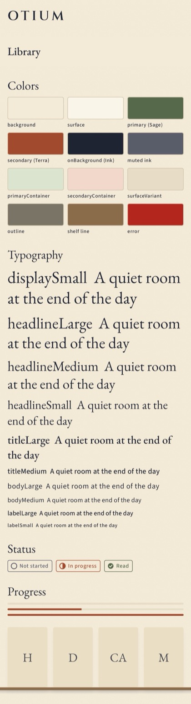
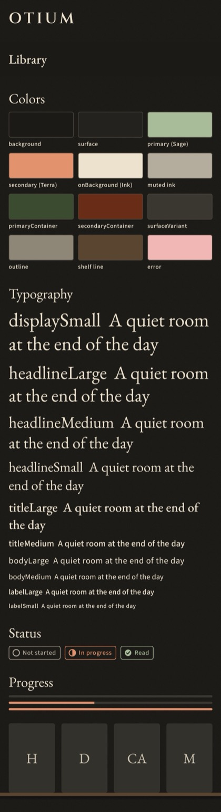
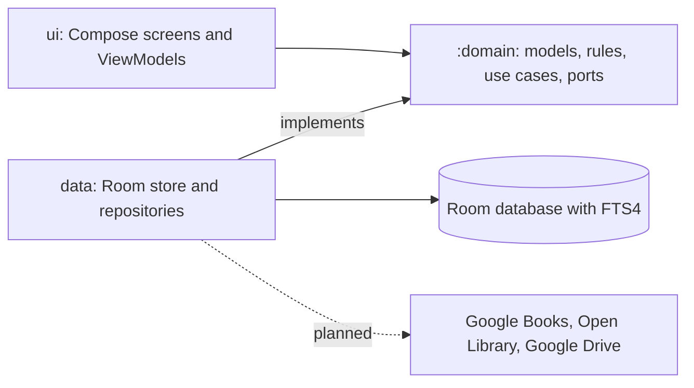

# Otium

Your personal Alexandria library.

[](https://github.com/eh0x/otium/actions/workflows/ci.yml)
[](LICENSE)

Otium is an Android app for cataloguing and tracking your own physical books. Scan an ISBN, let it
fetch the details, keep your place by page, and find any book in your library in an instant. It is
built to feel like a quiet study rather than a utility, and it keeps your data on your device.

> [!NOTE]
> Otium is in early development and is not usable yet. The foundation is in place: the domain
> rules, the on-device library database with search and filters, and the visual identity. The
> screens, book lookup, barcode scanning and backup are still being built. See
> [Status](#status).

## Contents

- [Key features](#key-features)
- [Status](#status)
- [Screenshots](#screenshots)
- [Privacy](#privacy)
- [Tech stack](#tech-stack)
- [Getting started](#getting-started)
- [Everyday commands](#everyday-commands)
- [Testing](#testing)
- [Architecture](#architecture)
- [Project structure](#project-structure)
- [Documentation](#documentation)
- [Troubleshooting](#troubleshooting)
- [Contributing](#contributing)
- [Acknowledgements](#acknowledgements)
- [License](#license)

## Key features

Planned for version 1:

- **Add books three ways.** Scan the barcode, type an ISBN, or search by title or author.
- **Good metadata, fixed by you.** Details and covers come from Google Books, with Open Library
  filling the gaps. A confirm screen always comes before saving, because API data is often wrong,
  and every field and the cover can be edited.
- **Reading progress by page.** Set the current and total page. A book is _not started_, _in
  progress_ or _read_, worked out from the pages, and shown as a quiet percentage bar.
- **Search and filters.** Instant text search over title and author, filtered by status, category
  and tag, with several sort orders. Built for a library of around 5,000 books.
- **Works offline.** Browsing, searching and updating progress need no network.
- **Backup to your own Google Drive.** A manual backup button and an optional scheduled backup,
  stored in your private app folder in Drive.

Not in version 1: iOS, syncing between devices, accounts or a backend, ratings and notes, reading
statistics, social features, and several copies of the same ISBN.

## Status

The work follows [the implementation plan](docs/plans/2026-10-06-otium-implementation-plan.md).

| Phase | What | State |
|-------|------|-------|
| 0 | Project scaffold, CI | Done |
| 1 | Theme: palette, fonts, shared components | Done |
| 2 | Domain rules and the Room library store | Done |
| 3 | Library and book detail screens | Done (device timings still to take) |
| 4 | Metadata lookup (Google Books, Open Library) | Done (device check still to do) |
| 5 | Add flow: scan, ISBN, title search | Planned |
| 6 | Backup and restore with Google Drive | Planned |
| 7 | Polish, accessibility, Play Store release | Planned |

The plan holds the detail and is kept current; this table is a summary.

## Screenshots

There are no app screenshots yet. These are renders of the design system (the theme catalog that debug
builds show), in the light and dark themes: parchment, sage, terra and ink, with EB Garamond
headlines and a quiet sans for interface text.

| Light | Dark |
|-------|------|
|  |  |

## Privacy

These are design commitments for version 1:

- Your library stays on your device. There are no accounts and no analytics.
- The only network calls are to the book APIs, sending an ISBN or a title and author, and to your
  own Google Drive for backup.
- Backups use the private app data folder of your Drive (the `drive.appdata` scope), which the
  app alone can read.

## Tech stack

- **Language and UI:** Kotlin, Jetpack Compose with Material 3, and a custom theme.
- **Data:** Room with an FTS4 full-text index; Kotlin coroutines and Flow.
- **Dependency injection:** Hilt.
- **Planned:** CameraX and ML Kit for barcode scanning, Retrofit with kotlinx.serialization for the
  book APIs, Coil for covers, WorkManager for scheduled work, and Google Identity Services for
  Drive.
- **Quality:** Spotless with ktlint, detekt, Android Lint, markdownlint, and architecture rules
  written as tests (Konsist).
- **Tests:** JUnit, Turbine, Robolectric.

Library versions are pinned in [`gradle/libs.versions.toml`](gradle/libs.versions.toml).

## Getting started

### Requirements

- JDK 17
- Android SDK with platform 37 and build-tools 37 (Android Studio installs these; the command-line
  tools work too)
- Git
- Node.js, optional: only the Markdown lint needs it, and it is skipped when Node.js is missing

The minimum supported Android version is 8.0 (minSdk 26). The application id is `app.otium`.

### Clone

```bash
git clone https://github.com/eh0x/otium.git
cd otium
```

### Configure

Create `local.properties` in the repository root. It is git-ignored and never committed.

```properties
sdk.dir=/path/to/Android/sdk
# Optional. Used by the book lookup (Phase 4). Without it Google rejects most requests, and
# the lookup relies on Open Library.
books.api.key=YOUR_GOOGLE_BOOKS_API_KEY
# Optional. How Open Library can reach you; sent in the User-Agent header. Defaults to the
# project page. An email or phone number gives a higher request limit.
openlibrary.contact=you@example.org
```

| Key | Required | Meaning |
|-----|----------|---------|
| `sdk.dir` | Yes, unless `ANDROID_HOME` is set | Location of the Android SDK |
| `books.api.key` | No | Google Books API key, restricted by package name and SHA-1 |
| `openlibrary.contact` | No | Contact for Open Library's User-Agent; default is the project page |

### Enable the git hooks

```bash
./gradlew installGitHooks
```

This points git at the hooks in `.githooks`: formatting and Markdown checks on commit, a
Conventional Commits check on the message, and the test suite on push. The hooks look for a JDK in
the usual places and skip the local run when none is found; CI runs the same checks either way.

### Build and run

```bash
./gradlew assembleDebug
./gradlew installDebug
```

The first builds the debug APK (at `app/build/outputs/apk/debug/app-debug.apk`); the second
installs it on a connected device or a running emulator. Until the real screens exist, the debug
build opens the theme catalog shown above.

## Everyday commands

| Command | What it does |
|---------|--------------|
| `./gradlew assembleDebug` | Build the debug APK |
| `./gradlew installDebug` | Install the debug build on a device or emulator |
| `./gradlew assembleRelease` | Build the unsigned, R8-shrunk release APK |
| `./gradlew testDebugUnitTest :domain:test` | Run all unit tests |
| `./gradlew :benchmark:connectedBenchmarkAndroidTest` | Run the scroll and search benchmarks on a device or emulator (see below) |
| `./gradlew spotlessApply` | Fix formatting of Kotlin, Gradle, XML and text files |
| `./gradlew spotlessCheck detekt lint` | Check formatting, static analysis and Android Lint |
| `./gradlew checkDocs lintMarkdown` | Check that docs match the repository, and lint Markdown |
| `./gradlew check` | Run every verification task |

CI runs the same checks (see `.github/workflows/ci.yml`). To reproduce a CI run locally:

```bash
./gradlew spotlessCheck detekt checkDocs lintMarkdown lint testDebugUnitTest :domain:test assembleDebug
```

## Testing

Everything runs on the JVM, so no device or emulator is needed:

- **Domain tests** cover the pure rules: status, page clamping, ISBN validation, metadata merge.
- **Data tests** run the real Room database under Robolectric: search, every filter and sort,
  constraints, change notification, and a 5,000-book latency guard.
- **UI tests** check the theme, the contrast of the palette in both themes (WCAG), component
  semantics and a headless render of the theme catalog, written to `app/build/screenshots`.
- **Architecture tests** fail the build when a layering rule breaks, for example when the UI layer
  imports the data layer or a ViewModel imports an Android type.

The 5,000-book timings measured on the JVM are a regression guard, not device numbers. Device
numbers come from the `:benchmark` module, which seeds 5,000 books through the debug seeder and
records frame timing while scrolling the shelf and typing in search. It needs a device or emulator.
On an emulator add `-Pandroid.testInstrumentationRunnerArguments.androidx.benchmark.suppressErrors=EMULATOR`;
its numbers only compare one run with another.

## Architecture



- **Three Gradle modules.** `:domain` is pure Kotlin and cannot import Android, Room or Hilt; the
  compiler enforces it. `:app` holds the UI, the data layer and the wiring. `:benchmark` holds the
  Macrobenchmark tests and ships nothing.
- **Room is the source of truth.** The UI observes database flows; network results are written into
  the database.
- **Interfaces belong to the consumer.** Repository and port interfaces live in `:domain` and are
  implemented in the data layer.
- **Status is derived, never stored,** from the current and total page, so it cannot drift.
- **Expected failures are values.** Functions return a typed `Try` with an `AppError`, instead of
  throwing across layers.

The reasoning behind each choice, with alternatives, is in
[the design document](docs/design/2026-10-06-otium-library-app-design.md).

## Project structure

```text
otium/
├── app/             Android app (:app)
│   └── src/main/kotlin/app/otium/
│       ├── ui/          Compose theme, shared components, theme catalog
│       ├── data/        Room store and repositories
│       └── di/          Hilt modules
├── benchmark/       Macrobenchmark tests for scroll and search (:benchmark)
├── domain/          Pure Kotlin (:domain): models, rules, use cases, ports
├── docs/            Design, plan, style and Markdown guides
├── config/detekt/   Static analysis rules
├── gradle/          Version catalog and build scripts
├── scripts/         Documentation and Markdown checks
├── third_party/     Font licenses
└── .githooks/       Git hooks (enabled by installGitHooks)
```

## Documentation

- [Design document](docs/design/2026-10-06-otium-library-app-design.md): what is built and why,
  with the decision log.
- [Implementation plan](docs/plans/2026-10-06-otium-implementation-plan.md): phases, tasks and
  status.
- [Style guide](docs/STYLE_GUIDE.md): code rules, architecture rules and how each is enforced.
- [Markdown guidelines](docs/MARKDOWN_GUIDE.md): how documentation is written and linted.
- [Open source guidelines](docs/OPEN_SOURCE_GUIDELINES.md): standards and best practices for
  project governance, issue triage, security, and community.
- [Security policy](SECURITY.md): supported versions and how to report a vulnerability privately.

Docs live in the repository and change with the code. `./gradlew checkDocs` fails when this README
or the guides drift from the build files, and CI warns when setup or tooling changes come without a
docs update. Who owns which document, and the `Docs: n/a - <reason>` commit trailer, are in
[the style guide](docs/STYLE_GUIDE.md#8-documentation).

## Troubleshooting

**`SDK location not found`.** Create `local.properties` with `sdk.dir`, or set `ANDROID_HOME`. See
[Configure](#configure).

**`Unable to locate a Java Runtime`, or an unsupported class version.** The build needs JDK 17. On
macOS, `/usr/bin/java` exists even with no JDK installed, so check `java -version` and set
`JAVA_HOME` to a JDK 17 installation if it is not on your `PATH`. With Homebrew, point it at
`$(brew --prefix openjdk@17)/libexec/openjdk.jdk/Contents/Home`, not the keg root; Kotlin fails
there with "No class roots are found in the JDK path".

**`Failed to find Platform SDK` or missing build-tools.** Install platform 37 and build-tools 37:

```bash
sdkmanager "platforms;android-37.0" "build-tools;37.0.0"
```

**A commit or push is blocked.** Read the message: formatting is fixed with
`./gradlew spotlessApply`, Markdown findings are listed by file and line, and commit subjects must
follow Conventional Commits (`type(scope): subject`). The hooks are a convenience; CI is the gate.

**`checkDocs` fails.** A doc disagrees with the repository, for example a command that no longer
exists or a stale fact. Update the doc in the same change.

**The first test run is slow.** Robolectric downloads the Android runtime it simulates once, and
Gradle downloads dependencies; later runs are fast.

## Contributing

Otium is an early-stage project, and issues and ideas are welcome on the
[issue tracker](https://github.com/eh0x/otium/issues). For anything larger than a small fix,
please open an issue to discuss it before writing code.

To work on a change:

1. Follow [Getting started](#getting-started) and enable the git hooks.
2. Branch from `develop` and keep each commit to one logical change, with a
   [Conventional Commits](https://www.conventionalcommits.org/) subject.
3. Write the test first for logic, queries and parsers. Follow the [style guide](docs/STYLE_GUIDE.md).
4. Run `./gradlew check` and fix what it reports, including the docs.
5. Open a pull request against `develop` and complete the checklist in the template.

## Acknowledgements

- Book data and covers are planned to come from the [Google Books API](https://developers.google.com/books)
  and [Open Library](https://openlibrary.org), used within their terms and with the required
  attribution.
- Fonts: [EB Garamond](https://github.com/octaviopardo/EBGaramond12),
  [Source Sans 3](https://github.com/adobe-fonts/source-sans) and
  [Cinzel](https://github.com/NDISCOVER/Cinzel), all under the SIL Open Font License. The license
  texts are in `third_party/fonts`.

## License

Otium is released under the [Apache License 2.0](LICENSE).
