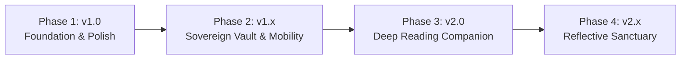

# Otium product and technical roadmap

Date: 2026-10-06
Status: Validated through brainstorming
Related documents: [app design](design/2026-10-06-otium-library-app-design.md),
[implementation plan](plans/2026-10-06-otium-implementation-plan.md), [style guide](STYLE_GUIDE.md)

## 1. Overview and vision

Otium is an Android personal library sanctuary built on the philosophy of "analog sanctity"—a
dignified, distraction-free environment that treats reading as a tranquil pursuit rather than a
gamified metric.

This document lays out the strategic evolution of Otium from its initial v1.0 cataloguing release
into a hardened, mature, and secure lifelong reading companion. It maps out identified functional
and architectural gaps, establishes a hardened security posture, and introduces deep reading tools
without compromising the app's quiet offline-first ethos.



## 2. Identified gaps in the current baseline

A review of the active v1 architecture and implementation reveals five major vectors where the
application can mature:

- **Security and privacy:** Room stores plaintext SQLite data on disk; Google Drive backups are
  unencrypted ZIP archives; and the app has no biometric authentication gate to guard private
  reading journals and personal library records.
- **Data mobility and vendor lock-in:** No import or export capabilities exist. Users cannot bring in
  their existing libraries from Goodreads or StoryGraph, nor can they export their catalog to open
  JSON or CSV formats.
- **Cataloguing throughput:** Adding books requires single-item confirmation. Cataloguing an entire
  bookshelf or newly purchased stack of books is slow without a continuous batch scanning mode.
- **Reading depth and formats:** The v1 model only tracks physical book page numbers. It cannot
  accommodate e-books (percentages) or audiobooks (runtime), nor does it capture margin thoughts,
  excerpts, quotes, or multiple read sessions.
- **Ownership and lending:** Readers often lend books to friends and family with no way to track who
  holds which physical volume, leading to lost books over time.

## 3. Assumptions and constraints

- **Target platform:** Native Android exclusively (Jetpack Compose, Kotlin coroutines/Flow,
  minSdk 26). No iOS, web, or desktop targets planned.
- **Architecture:** Clean Architecture with strict separation between pure-Kotlin `:domain` (JVM
  only, zero Android/framework imports) and `:app`.
- **Privacy and zero-backend:** No proprietary backend, no developer-held accounts, no remote
  tracking or telemetry. All user data resides on-device and in the user's private Google Drive.
- **Sanctuary philosophy:** Explicit rejection of toxic gamification: zero streak counters, zero
  dopamine badges, and zero guilt notifications. Insights are retrospective, quiet, and reflective.
- **Accessibility:** Strict adherence to WCAG AA color contrast (minimum 4.5:1 for text, 3:1 for
  graphical elements) across both light and dark themes.

## 4. Decision log

| # | Decision | Alternatives considered | Why chosen |
|---|---|---|---|
| D-RM1 | Adopt Phased Evolutionary Roadmap (Approach 1) | Feature-first; Strict utility | Hardening security and open data mobility early prevents data loss and avoids difficult database migrations later. |
| D-RM2 | SQLCipher on-disk database encryption | Plaintext SQLite; File-level encryption | Full cryptographic protection of book records, private notes, and reading habits against physical device extraction. |
| D-RM3 | Hardware-backed key management via Android Keystore | Hardcoded salt; Raw user passphrase only | Hardware-backed key wrapping prevents offline extraction while supporting biometric unlock. |
| D-RM4 | Client-side AES-256-GCM encrypted cloud backups | Unencrypted Drive ZIP; Google Drive full scope | Ensures zero-knowledge cloud backups; Drive storage only ever sees ciphertext. |
| D-RM5 | Polymorphic multi-format reading model | Physical pages only; Format string tags | Cleanly models physical pages, e-book percentage, and audiobook runtime while normalizing progress (0–100%). |
| D-RM6 | On-device ML Kit OCR for excerpt capture | Cloud vision APIs; Manual typing only | Fast, fully private, works offline, and incurs zero server costs. |
| D-RM7 | Non-gamified reflective reading insights | Daily streaks and badges; No analytics | Preserves the calm, guilt-free reading sanctuary while offering meaningful retrospectives. |
| D-RM8 | Local-only lending tracker | Google Contacts integration; Calendar alarms | Privacy-first; eliminates unnecessary runtime permission prompts. |
| D-RM9 | Continuous batch barcode scanning with background resolution | Blocking camera flow; External barcode scanners | Maximizes ingestion speed when cataloguing whole bookshelves without UI freezes. |
| D-RM10 | Jetpack Compose Glance home screen widget | Legacy RemoteViews; No widget | Cohesive with the "Earth & Ink" theme and provides glanceable reading progress without opening the app. |
| D-RM11 | Encrypted backups first, biometric app lock second, SQLCipher deferred (changes the order and scope of D-RM2 to D-RM4; review S4) | SQLCipher first, as planned | The backup is the only copy that leaves the phone, and Android's file-based encryption already protects the database on the device. SQLCipher adds native libraries and makes a lost key mean lost data. Revisit it when private notes arrive. |

## 5. Phased roadmap

### Phase 1: v1.0 Foundation and polish (Current in-flight milestone)

The baseline release establishes the core cataloguing experience, reliable metadata resolution,
and the "Earth & Ink" design system.

- **Barcode scanning:** CameraX and ML Kit integration for single-book ISBN-13 scanning with haptic
  feedback and checksum validation.
- **Metadata merge:** Parallel queries to Google Books and Open Library with field-level merging and
  graceful fallback.
- **Library browsing:** Dual-mode display (analog shelf view and compact list view), FTS4 full-text
  search, and multi-group filter chips (status, categories, custom tags).
- **Progress tracking:** Page-based reading progress with percentage calculation and status
  derivation (Not Started, In Progress, Read).
- **Basic cloud backup:** Manual and scheduled backup of database and covers to Google Drive
  `appDataFolder`.
- **Quality baseline:** WCAG AA contrast enforcement, Roborazzi screenshot tests, and architecture
  purity validation.

### Phase 2: v1.x Sovereign vault and open data mobility

Focuses on rock-solid security, privacy, and full data sovereignty so users can trust Otium with
their lifelong libraries without lock-in.

#### Security hardening

- **SQLCipher integration (deferred, D-RM11):** 256-bit AES database encryption using SQLCipher
  for Android. Existing unencrypted v1 databases are migrated automatically on first launch via a
  temporary in-memory SQLCipher bridge.
- **Biometric app lock:** Integrated Android `BiometricPrompt` supporting fingerprint, facial
  recognition, and device PIN. Includes configurable auto-lock timeouts (immediate, 1 minute, 5
  minutes) and dynamic `FLAG_SECURE` window masking in the Android app switcher.
- **Client-side encrypted backups (done for Drive backups):** with a passphrase set, Drive
  backups are encrypted with AES-256-GCM (Tink streaming AEAD) under a key derived with Argon2id.
  Manual exports will use the same format when they arrive.

#### Open data mobility

- **Goodreads CSV import:** Complete importer parsing Goodreads export archives, mapping reading
  shelves (`read`, `currently-reading`, `to-read`) to Otium statuses, and preserving user ratings
  and read dates.
- **StoryGraph CSV import:** Support for StoryGraph reading export formats.
- **Native Otium archive format:** Lossless backup and restore archive (`.otium` / ZIP) bundling
  the encrypted database, high-resolution covers, custom tags, and notes.
- **Import staging and conflict resolution:** A preview sheet displaying parsed entries before
  insertion, with conflict resolution options: _Skip duplicates_, _Update existing_, or _Merge
  progress_. Unresolved ISBNs are scheduled for background metadata enrichment.
- **Universal CSV export:** One-tap export to open CSV format for spreadsheet inspection or backup.

### Phase 3: v2.0 Deep reading and multi-format companion

Transforms Otium from a passive cataloguing app into an active reading companion for diverse book
formats and personal thoughts.

#### Multi-format tracking

- **Format polymorphism:** First-class models for Physical, E-Book, and Audiobook editions.
  - _Physical:_ Tracked by current page and total pages.
  - _E-Book:_ Tracked by reading percentage (`0.0% – 100.0%`) or virtual page numbers.
  - _Audiobook:_ Tracked by runtime seconds (`CurrentPosition` / `TotalDuration`), formatted
    as `4h 12m of 11h 30m`.
- **Normalized progress:** All formats project a normalized 0–100% progress metric to the shelf
  and list views.
- **Re-reading journeys:** Support for multiple reading sessions per book (`datesRead:
  List<DateRange>`), preserving historical read milestones.

#### Margin notes and personal journal

- **Quiet markdown notes:** Built-in distraction-free Markdown editor on the Book Detail screen for
  personal reflections, chapter summaries, and literary notes.
- **Full-text search indexing:** Notes are indexed in the Room FTS table, enabling global library
  searches for thoughts and ideas written while reading.

#### Quotes and camera OCR excerpt capture

- **On-device OCR scanner:** Point the camera at a physical book page; ML Kit Text Recognition
  identifies text blocks with interactive tap-to-select functionality.
- **Quote management:** Save selected passages with page number, chapter title, and optional tags.
- **Styled quote cards:** Render quotes into shareable typographic cards using the Otium brand
  palette (EB Garamond font on textured Parchment) with book and author attribution.

#### Lending and borrowing tracker

- **Loan management:** Mark any physical volume as _Loaned Out_ with borrower name, date lent, and
  target return date.
- **Shelf visualization:** A subtle linen ribbon badge appears on the book spine in shelf view.
- **Privacy-first:** Contact names entered as plain text with zero invasive address book permission
  requests.

### Phase 4: v2.x Reflective sanctuary and ecosystem delighters

Introduces power-user ingestion tools, home screen integration, and contemplative analytics.

#### Continuous batch barcode scanning

- **Shelf cataloguing mode:** A continuous viewfinder mode allowing users to scan consecutive
  barcodes from a physical shelf or stack of books.
- **Non-blocking background lookup:** Scanned ISBNs queue immediately with subtle haptic ticks while
  metadata lookups run concurrently in the background.
- **Batch review tray:** A swipeable tray allowing bulk tag application (e.g., `Living Room
  Shelf`, `History`) and batch persistence in a single transaction.

#### Reflective reading insights (Non-gamified)

- **Yearly and monthly retrospectives:** Visual "Year in Books" showing completed works chronologically.
- **Reading rhythms:** Quiet charts showing reading pace and volume across seasons and months
  without pressure or daily streak targets.
- **Literary discovery map:** Visual breakdown of genres, publication eras, and frequent authors.

#### System and shelf delighters

- **Android Glance widget:** Clean home screen widget showing current book cover, reading
  progress bar, and quick page advance buttons (`+1`, `+5` pages).
- **Physical bookshelf locations:** Custom virtual collections representing real-world shelving
  locations (e.g., _Study Oak Shelf_, _Bedside Stack_, _Attic Box 2_).
- **Offline metadata cache:** Local caching of cover assets and author catalogs to preserve battery
  and bandwidth when roaming.

## 6. Architectural and technical specifications

### Module evolution

The modular boundary remains strict: `:domain` defines core contracts, while `:app` provides
Android platform implementations.

```text
:domain
  model/
    Book, BookFormat (Physical, EBook, Audio), ReadingSession,
    Note, Quote, LendingRecord, ReadingReflection, LibraryExport
  port/
    VaultSecurity, BiometricAuthenticator, LibraryExporter,
    LibraryImporter, OcrTextExtractor
  usecase/
    UnlockVault, ImportLibrary, ExportLibrary, SaveQuoteFromOcr,
    TrackBookLoan, CalculateReadingInsights

:app
  data/
    security/   SqlCipherOpenHelper, KeystoreKeyManager, BiometricManager
    io/         GoodreadsCsvParser, StoryGraphCsvParser, JsonArchiveCodec
    ocr/        MlKitTextRecognition
  ui/
    vault/      BiometricLockScreen, PassphrasePrompt
    insights/   ReflectionsScreen, AnnualSummarySheet
    notes/      QuotesAndNotesCard, ExcerptOcrScannerScreen
    widget/     OtiumGlanceWidget, WidgetReceiver
```

### Database migration strategy

To prevent data corruption across schema expansions, all database modifications follow explicit
Room migrations backed by automated unit tests using `MigrationTestHelper`:

```kotlin
// Example migration path for multi-format and lending
val MIGRATION_1_2 = object : Migration(1, 2) {
    override fun migrate(db: SupportSQLiteDatabase) {
        db.execSQL("ALTER TABLE book ADD COLUMN format TEXT NOT NULL DEFAULT 'PHYSICAL'")
        db.execSQL("ALTER TABLE book ADD COLUMN audioDurationSeconds INTEGER DEFAULT NULL")
        db.execSQL("ALTER TABLE book ADD COLUMN audioPositionSeconds INTEGER DEFAULT NULL")
        db.execSQL("ALTER TABLE book ADD COLUMN ebookPercentage REAL DEFAULT NULL")
        db.execSQL(
            """
            CREATE TABLE IF NOT EXISTS loan (
                id INTEGER PRIMARY KEY AUTOINCREMENT NOT NULL,
                bookId INTEGER NOT NULL,
                borrowerName TEXT NOT NULL,
                loanedAt INTEGER NOT NULL,
                dueAt INTEGER,
                returnedAt INTEGER,
                FOREIGN KEY(bookId) REFERENCES book(id) ON DELETE CASCADE
            )
            """.trimIndent()
        )
    }
}
```

### Non-functional targets

- **Search latency:** Sub-50 ms prefix queries across 10,000 books via Room FTS4.
- **Cold start overhead:** Sub-400 ms startup time with SQLCipher key decryption and Room initialization.
- **Import throughput:** Ingest and index 1,000 Goodreads records in under 3 seconds with background
  threading and progress indicators.
- **Crash tolerance:** Strict typed error propagation using `Try<T>` and `AppError`; zero unhandled
  SQLite or network exceptions.
- **Battery footprint:** Periodic backup and sync workers restricted to Wi-Fi and device charging
  constraints via WorkManager.

## 7. Risk matrix and mitigation

| Risk | Impact | Likelihood | Mitigation |
|---|---|---|---|
| Database encryption failure on update | Critical | Low | Backup unencrypted database to a temporary encrypted staging file; verify integrity before replacing original SQLite file. |
| Malformed external CSV rows | Medium | High | Two-stage import pipeline (parse and validate into preview models before batch database insertion). |
| Keystore key invalidation (biometric change) | High | Low | Offer user passphrase fallback to derive the master decryption key if biometric enrollment changes. |
| OCR extraction inaccuracies | Low | Medium | Provide an editable preview sheet allowing users to tweak scanned excerpt text prior to saving. |
| API rate limits during batch import | Medium | Medium | Queue missing ISBNs in `WorkManager` with exponential backoff and low-concurrency execution. |
