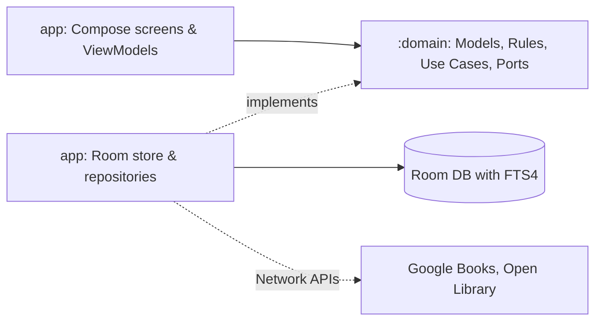

# Otium Architecture Document

This document was generated automatically by analyzing the repository checkout. It provides a
definitive, cited architecture view of the codebase on disk.

## Part 1 — Whole-repo technical deep-dive

**What the repository is:** Otium is an Android app for cataloguing and tracking physical books. It
allows users to scan an ISBN, fetch details, keep their place by page, and find any book in their
library instantly. It is built to feel like a quiet study rather than a utility, and it keeps user
data on their device. ([README.md](../README.md))

### Tech-Stack Detection

| Layer | Technology | Evidence |
|-------|------------|----------|
| Build / Task Runner | Gradle | `build.gradle.kts` |
| Language | Kotlin | `gradle/libs.versions.toml#L4` |
| UI Toolkit | Jetpack Compose (Material 3) | `gradle/libs.versions.toml#L18`, `README.md#L94` |
| Data Store | Room with FTS4 | `gradle/libs.versions.toml#L23`, `build.gradle.kts#L13` |
| Dependency Injection | Hilt | `gradle/libs.versions.toml#L30` |
| Image Loading | Coil | `gradle/libs.versions.toml#L38` |
| Network | Retrofit & OkHttp | `gradle/libs.versions.toml#L35-L36` |
| JSON Parsing | kotlinx.serialization | `gradle/libs.versions.toml#L33` |
| Barcode Scanning | CameraX & ML Kit | `gradle/libs.versions.toml#L26-L29`, `gradle/libs.versions.toml#L40` |
| Testing | JUnit, Turbine, Robolectric, MockWebServer, Konsist | `gradle/libs.versions.toml#L48-L54` |

### Entry Points

- The primary entry point is the Android Application in the `:app` module.

### Commands & Verification Inventory

| Command | Purpose | Evidence |
|---------|---------|----------|
| `./gradlew assembleDebug` | Build the debug APK | `README.md#L179` |
| `./gradlew installDebug` | Install the debug build | `README.md#L180` |
| `./gradlew assembleRelease` | Build the shrunk release APK | `README.md#L181` |
| `./gradlew testDebugUnitTest :domain:test` | Run all unit tests | `README.md#L182` |
| `./gradlew spotlessCheck detekt lint` | Check formatting, static analysis, Android Lint | `README.md#L185` |
| `./gradlew spotlessApply` | Fix formatting | `README.md#L184` |
| `./gradlew :benchmark:connectedBenchmarkAndroidTest`| Run scroll and search benchmarks on a device | `README.md#L183` |
| `./gradlew scanSecrets` | Scan the git history for secrets with gitleaks | `README.md#L187` |
| `./gradlew scanDependencies` | Scan shipped dependencies for vulnerabilities | `README.md#L188` |
| `./gradlew check` | Run every verification task | `README.md#L189` |

**CI Configuration:**

- **Triggers:** Push to `main` and `develop`, and `pull_request` (`.github/workflows/ci.yml#L3-L6`).
- **Enforcement:** `[UNVERIFIED]`. Branch protection rules cannot be inferred purely from the
repository configuration without checking GitHub settings.
- **Workflow Steps:** Runs Markdown lint, Spotless, Detekt, CheckDocs, Secret Scan (Gitleaks),
Dependency Scan (OSV-Scanner), Android Lint, Unit Tests (Kover Coverage), and Build.
(`.github/workflows/ci.yml`)

### Directory Layout

| Directory | Purpose |
|-----------|---------|
| `app/` | Main Android app module holding the UI, data layer (Room), and Hilt wiring. |
| `domain/` | Pure Kotlin module holding models, rules, use cases, and interfaces (ports). |
| `benchmark/` | Macrobenchmark tests for scroll and search timing. |
| `docs/` | Design, planning, style, and Markdown documentation. |
| `gradle/` | Build scripts and the `libs.versions.toml` dependency catalog. |
| `scripts/` | Shell scripts for secret scanning, dependency scanning, and docs checking. |

### Deployment & Runtime Surface

| Component | Pinned Version / Setting | Evidence |
|-----------|--------------------------|----------|
| CI Java Runtime | Temurin JDK 17 | `.github/workflows/ci.yml#L29-L30` |
| Local Build JDK | JDK 17 | `README.md#L111` |
| Android Platform | 37 | `README.md#L112` |
| Android minSdk | 26 (Android 8.0) | `README.md#L120` |

### EOL / Dead-Dependency Scan

- The codebase relies on actively maintained dependencies specified in `gradle/libs.versions.toml`.
There are no identified EOL frameworks or deprecated dependencies inferred from the current project
structure.

### Systems

- **Data/Storage:** Room Database (local device).
- **Network API:** Google Books API (primary) and Open Library (fallback).
- **Background Jobs:** WorkManager (for metadata lookups that wait for a connection).

---

## Part 2 — Context & ecosystem

### Local Checkout Identity

| Property | Value |
|----------|-------|
| Remote | `git@github.com:eh0x/otium.git` |
| Branch | `develop` |
| HEAD Commit | `297798263d38fbab16c6f97a353b2dfbf6f3cdd1` |
| License | Apache 2.0 |

### Developer Gotchas & Repo-Specific Rules

- **Formatting:** `ktlint` and `spotless` format the code. Do not hand-format against `ktlint`.
(`CLAUDE.md#L15`)
- **Commits:** Conventional Commits are enforced by a commit-msg hook. (`CLAUDE.md#L16`)
- **JDK Requirement:** Temurin JDK 17 must be used. Do not use Homebrew's keg-only `openjdk@17` as
it causes file permission errors (`CLAUDE.md#L20-L24`).
- **Secret Scanning:** `gitleaks` is required for secret scanning in git hooks. False positives are
handled in `scripts/scan-secrets.sh`. (`README.md#L315-L318`)
- **Agent Guidelines:** Use the `graphify` tool for codebase queries as documented in `CLAUDE.md`.

### Ecosystem Relations

- The app operates independently but integrates with the Google Books API and Open Library API to
fetch metadata. A Google Books API Key should be set in `local.properties` (`README.md#L137`).
- Backup and restore features utilize the private app data folder in Google Drive (`drive.appdata`
scope).

---

## Part 3 — Architectural blueprint

### Tech-Stack Summary

Native Kotlin Android Application utilizing Jetpack Compose, Room (FTS4), and Hilt. Strict
separation of concerns via a multi-module setup (`:app`, `:domain`, `:benchmark`).

### Architecture Context & Container Diagram

### Layering and Dependency Rules

- **Domain Purity:** The `:domain` module is pure Kotlin and cannot import Android, Room, or Hilt.
The compiler enforces this. (`README.md#L246-L247`)
- **Dependency Inversion:** Interfaces belong to the consumer. Repository and port interfaces live
in `:domain` and are implemented in the `app/data` layer. (`README.md#L251-L252`)
- **Architecture Tests:** Enforced by Konsist (`app/src/test/.../architecture`); fail the build if
a layering rule breaks (e.g., UI layer importing data layer). (`README.md#L209-L210`)

### Cross-Cutting Concerns

| Concern | Implementation / Location | Evidence |
|---------|---------------------------|----------|
| DI | Hilt (`app/src/main/kotlin/app/otium/di/`) | `README.md#L96`, App Structure |
| Code Formatting | Spotless & Ktlint | `build.gradle.kts#L44-L68` |
| Static Analysis | Detekt | `build.gradle.kts#L71-L76` |
| Vulnerability Scan | OSV-Scanner (CycloneDX SBOM) | `scripts/scan-dependencies.sh` |
| Error Handling | Typed `Try` with an `AppError` instead of exceptions across layers | `README.md#L254-L255` |

### Inferred Architectural Decision Records

- **D1: Android-only:** Selected over cross-platform solutions.
- **D2: Local Room DB + Google Drive backup:** Enhances privacy and offline-first capabilities.
- **D3: Google Books primary, Open Library fallback:** Ensures better coverage for metadata and
covers.
- **D5: Status derived from page, not stored:** Avoids data drift.
- **D9: Parallel lookup with field-level merge:** Fills gaps in book metadata optimally across
multiple sources.

### Governance & Enforcement Mechanisms

- Architecture constraints are strictly encoded as unit tests via Konsist (`DomainPurityTest`,
`ArchitectureTest`).
- Comprehensive CI via GitHub Actions acts as the primary gate to merge.
- Required hooks (`pre-commit`, `commit-msg`, `pre-push`) are enabled using `./gradlew
installGitHooks`.

### Subsystem Deep-Dive: Room Database with FTS4

The local database uses Room and implements an FTS4 (Full-Text Search) index to provide real-time,
low-latency search capabilities for the catalog.

- **Location:** `app/src/main/kotlin/app/otium/data/local/`
- **Data Model:** Normalized author, category, and tag tables enable seamless filtering and
scalable browsing.
- **Rules:** The UI layer does not manage state modifications directly. Instead, it observes
database flows, while network fetch results are written into the database first. Status is derived
dynamically using SQL queries to ensure zero drift. (`README.md#L249-L250`, ADR D5, D6, D8)

### Confidence Assessment

| Area | Confidence | Notes |
|------|------------|-------|
| Build Commands | **High** | Extracted from `README.md` and verified locally. |
| Codebase Structure | **High** | Directly mapped from disk. |
| Subsystems | **High** | Verified by architecture rules tests and `README.md`. |
| CI Enforcement | **[UNVERIFIED]** | CI scripts exist but branch protection relies on GitHub's manual configuration. |

### Footnotes - local file citations

- `README.md`: Primary reference for project definition, stack details, and daily commands.
- `build.gradle.kts`: Source of truth for formatting, static analysis plugins, and dependency
scanning tasks.
- `gradle/libs.versions.toml`: Version constraints and external dependency map.
- `CLAUDE.md`: AI instructions, constraints, and specific macOS JDK gotchas.
- `.github/workflows/ci.yml`: Definitions for continuous integration gating and linting workflows.
